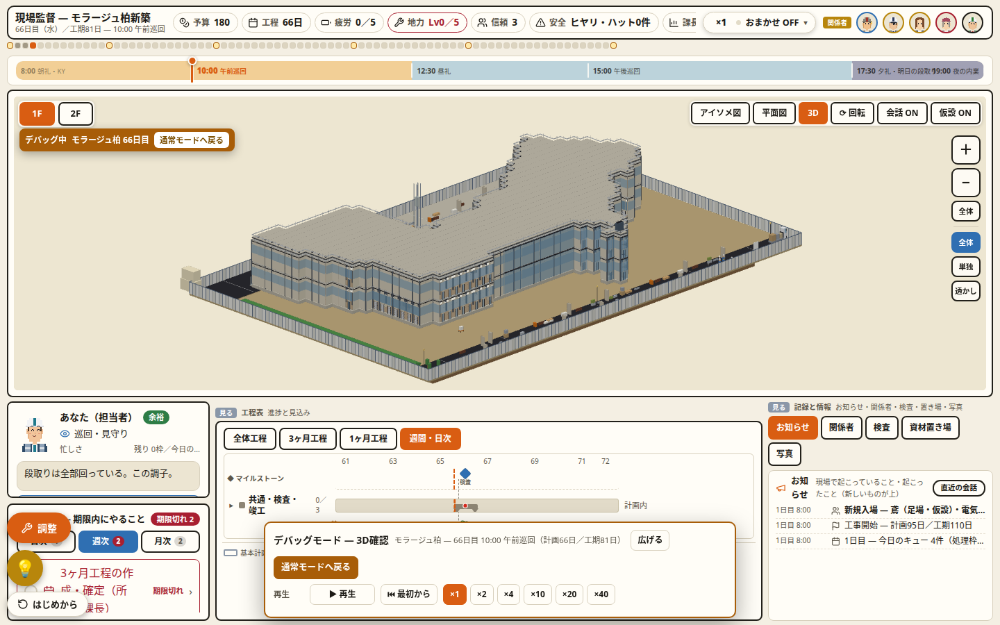

# 現場監督 — 立て直しの14日間

日本の建設現場の現場監督（施工管理）の仕事を体験するゲーム。健全な工程計画が外乱で崩れ、立て直していく過程が中核の、工程ネットワーク・シミュレーション。

**プレイ（GitHub Pages）**: https://tkhashi.github.io/construction-geme/ — `docs/` を GitHub Pages（ブランチ方式）で公開。本編を更新したら `game/index.html` と `docs/index.html` の両方へ反映する。

## 構成

| パス | 内容 |
|---|---|
| `game/` | 本編ゲーム（単一HTML）の正。`docs/index.html` がその公開用コピー（GitHub Pages） |
| `*.md`（ルート） | 設計文書群（QCDSEモデル、作業構造、登場人物、イベントプール等）。索引は `DOCUMENTS.md` |
| `model/` | 建物モデル／工事計画／3Dシーンの生成ロジックと仕様書。生成物JSON（`generated_*.json`）は再生成可能なため管理対象外 |
| `characters/` | 登場人物のプロファイルとドット絵素材（画像はローカル管理） |
| `stakeholder/` | 現場監督のステークホルダーマップ（drawio＋グラフJSON） |
| `research/` | 調査・試作用の置き場。区分ごとに README と撮影画像あり → [research/README.md](research/README.md) |

## 開発メモ

- 本編の正は Muse のスペース（Webアーティファクト）側で編集し、`game/index.html` へコピーして push する運用。
- 設計の正はユーザーの実務経験に基づく訂正 ＞ 調査資料 ＞ 外部ブログ素材、の順。

## ライセンス

MIT License（`LICENSE` 参照）。
