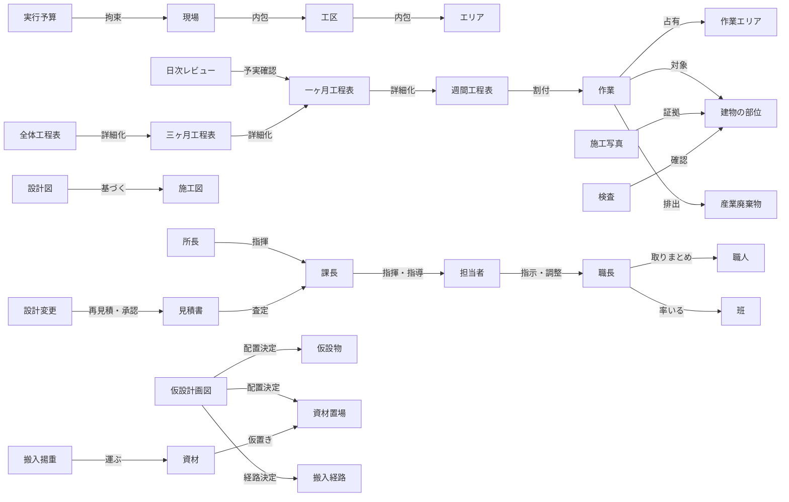

# 現場監督ドメインモデル v1

作成：2026-11-08
更新：2026-11-08（会話で確定した事項 U1〜U8 を反映。更新箇所には（2026-11-08 更新）の印を付けた）
素材：勉強会資料（tkhs発表）、ステークホルダー図、業務フロー図と1日/1ヶ月の業務例（画像）、現場ラボ（仮設計画・仕事術）、アルノのブログ抽出、空間把握の従来方法の調査、QCDSEモデル
機械可読版：`domain_model.json`（概念69・関係92・ルール23）

## このドメインの一文要約
現場監督の仕事とは、**「場所×時間」を占有し合う多数の作業を、図面と工程表と仮設計画を手がかりに、衝突させず・止めず・事故なく進め、証拠（写真と検査）を残しながら建物を完成させ、実行予算の範囲に収めること**である。

## コア概念の関係（要約図）

## 概念グループ

### 組織と人（16）
現場（作業所）、所長、課長、担当者、図面屋、協力業者（サブコン）、職長、職人、設計者、監理者、施主（建築主）、本社・支店、官公庁・確認検査機関、近隣・第三者、班（作業班）、課長の繁忙度（いずれも（2026-11-08 更新）で追加）。
関係の骨格はステークホルダーグラフと同じ：指揮命令（職長→担当者→課長→所長→本社）、契約（請負・下請・購買・リース）、承認・検査・許認可、苦情・要望（近隣のみ、契約なしで影響力を持つ）。
（2026-11-08 更新）人はパラメータを持つ存在として扱う：職長は 腕・段取り・協調性・積極性・動員力＋残業嫌悪・頼られ好き を持ち、業種ごとに傾向分布がある（鳶・鉄筋は協調性が低めで腕が高め、設備は協調性・積極性が高め、EVは腕・段取りが最高だが融通が利きにくい）。信頼は職長ごとに持つ。班は職人ごとの名簿（腕・素行）を持ち、出勤は日替わり。協力業者にも疲労があり、着工時に全社が揃わず工程に合わせて順次入場する。

### 計画と文書（19）
設計図、施工図（総合図／躯体図／仕上げ図／設備施工図／スリーブ図／製作図）、仮設計画図（総合仮設図）、施工計画書、工程表（全体／3ヶ月／1ヶ月／週間）、施工図作成工程表、作業指示書、作業日報、見積書、実行予算、安全書類、施工写真、議事録・打合せ記録、質疑応答書、指摘一覧、QC工程表、確認レコード（検査記録・指摘票・是正記録）。
読み方の要点：
- **設計図＝完成形と意図、施工図＝どう作るか**。施工判断の基準は施工図。
- **工程表は4層の詳細化チェーン**。全体（所長の大きな絵）→3ヶ月（課長）→1ヶ月→週間（日×場所×業者×人数×重機まで割付）。（2026-11-08 更新）ただし全体工程は着工時点で完成済みが前提で、作成が現場のタスクになるのは3ヶ月工程（所長＋課長）と1ヶ月工程（担当者作成→課長チェック）である。
- **施工写真は「記録」ではなく「証拠」**。隠蔽部は写真がなければ後から存在を主張できない。（2026-11-08 更新）撮影の単位は工区ではなく施工部材（実質は施工業者ごと）で、構造躯体・隠蔽部は多量、意匠・建具は抜粋。充足はカテゴリごとの充足率で判定する。

### 空間（9）
工区、エリア（階・部位）、資材置場（ヤード）、搬入経路・ゲート、作業エリア、動線、基準墨・通り芯・陸墨、置場スポット、敷地境界・敷地外環境（後の2つは（2026-11-08 更新）で追加）。
このドメインの特徴は、**空間そのものが管理対象のリソース**であること。時間だけでなく「どこに何を置くか／どこを誰が通るか／どこで誰が何をするか」を常に割り当て直す。基準墨・通り芯・陸墨は、現場という物理空間に埋め込まれた座標系として機能する。

### モノ（8）
資材・部材、重機、搬入車両、仮設物、看板・掲示物・区画表示、道具・工具、産業廃棄物、建物の部位・施工部分。
資材は「発注→搬入→仮置き→使用→（残材・産廃）」のライフサイクルを持ち、置場の容量と定位置（3定）に縛られる。仮設物は本設（建物として残るもの）と対の概念で、工程の進行に伴って配置が変わる。（2026-11-08 更新）置場は現場と独立した場所ではなく、建物内外の隙間（置場スポット）の集合であり、建物内スポットへの仮置きはその区画の内装開始を遅らせる。外部足場は面ごとに 組立→存置→解体 で進み、解体はその面の外装完了の宣言になる。

### 活動と出来事（17）
作業、キー工事、朝礼・KY・TBM、作業間連絡調整、巡回・パトロール、搬入・揚重、検査、指摘・是正、設計変更、打合せ・定例会議、新規入場者教育、引渡し、工程表作成タスク、資材置き場調整、日次レビュー、雨仕舞い（後の4つは（2026-11-08 更新）で追加）。
作業は「場所×時間の占有」としてモデル化するのが肝で、干渉（上下作業、重機と人の近接、同一通路の輻輳、火気と可燃物）は作業同士の関係として現れる。

## 対象物件と工程構造（2026-11-08 更新）
モデルの具体的な適用先として、会話で確定した対象物件と工程構造を置く。詳細設計は WORK_STRUCTURE_V2.md と BUILDING_SETTING.md。
- **物件（U1）**：S造3階・延床60,000㎡の商業施設。工区は各階 東/中/西の9工区＋共用部（吹抜け・EVコア）。平面は凸凹している（南面セットバック、東に荷捌き棟の張り出し、北西角は斜めカット、西面はシャフトの凹凸）。敷地境界と敷地外（幹線道路・住宅地など）も管理の対象に含む。
- **工程構造（U2）**：土工事（序盤の長いフェーズ。この間に先々の工程表作成と業者手配を進める＝段取りの runway）→基礎→鉄骨建方（建方→本締め・建入れ直し→デッキ→床配筋→打設→養生。S造が主役で、型枠・配筋のサイクルは基礎・土間に残る）。仮設足場は面ごとに組立→存置→解体。設備は電気・衛生・空調の3系統×3段階（躯体先行→隠蔽→器具付け・試験）で、衛生の水圧・満水試験が隠蔽前ゲート、受電が試運転の前提、空調の試運転調整は終盤に集中する。内装は 墨出し→LGS→隠蔽設備→隠蔽前検査→ボード→UB→パテ→仕上げ→床→建具・造作→器具付け のチェーンで、工区ごとにラップして流れる。外装は立面×階の独立レーン（ALC→サッシ→シーリング→塗装、カーテンウォール＋水密試験、屋根防水）で、雨仕舞いの4点セットが揃った面・階から内装が解放される。EVは昇降路引渡し→レール据付（危険作業）→試運転→落成検査→養生→工事用解放（搬送効率のバフ）の単独レーン。
- **検査のチェーン（U3）**：検査は「書類作成（証拠が材料）→申請・依頼（期限つきの明示行為）→実施（指摘→是正→再確認）」で初めて成立する。竣工時の検査群は 自主検査→監理者検査→施主検査→法定完了検査 の順。
- **工程表の作成（U4）**：全体工程は着工時点で完成済み。3ヶ月工程は所長＋課長が時間をかけて作り、確定の遅れは業者手配（入場・補充メンバーの質）を悪化させるが、メインの職人は変わらない。1ヶ月工程は担当者作成→課長チェックで、課長の繁忙度がチェック返却の速度を決め、出来の良し悪しが職人への指示の適切さに効く。担当者が下書きを肩代わりすると作成は速くなるが、巡回・写真が止まる。
- **空間と時間の割当（U6）**：置場・荷捌き・ゲート前・通路などの要所は午前/午後で割り当てる（資材置き場調整。2026-11-09 ユーザー確定の用語、旧称「時間貸し」）。遵守は確実ではなく、重要な箇所は巡回確認で確実化する。工程に余裕がある時期は職長同士の自律融通が働く。クレーンとゲートは時間枠の競合資源。
- **1日の締め（U8）**：1日の終わりは、1ヶ月工程表に対する日次レビュー→残業可否の決定→立て直し、という型で進む。残業は交渉であり、職長の抵抗・説得・最終拒否と、不満の蓄積/頼られ好きによる信頼上昇が絡む（U5）。

## 空間把握の方法と、モデル上の位置づけ
DX/ITに依存しない従来方法13件（調査済み）を、ドメインの言葉で整理すると次の4系統になる：

| 系統 | 方法 | モデル上の意味 |
|---|---|---|
| 計画で先に決める | 総合仮設計画図、工程表の階層運用への場所の落とし込み、揚重・搬入計画と予約調整 | 仮設計画図と工程表が「空間の予定」を保持する |
| 現物に埋め込む | 墨出し（基準墨・通り芯・陸墨）、物理的な区画と表示、5Sと3定 | 空間そのものに座標と意味を持たせる。図面を読まない人にも伝わる |
| 毎日同期する | 作業間連絡調整会議と本日の作業エリア図、朝礼・TBM・現地KY、新規入場者教育の現場一巡 | 「今日の現場地図」を人の頭と掲示に再配布する儀式 |
| 現物で確かめ続ける | 巡回・パトロール、搬入ルートの実測と最終踏査、工事写真と小黒板、作業日報・作業指示書 | 計画と現物の差分を検出し、記録として場所に紐づけて残す |

## 検証の2つの業務（詳細は別ファイル）
- **図面チェック**（詳細：TASKS_DRAWING_CHECK.md）：判定基準は常に設計図書であり施工図ではない。承諾は書面の申し出への書面の了解で、口頭確認は承諾ではない。施工図の流れは 総合図→躯体図/仕上げ図/設備施工図→スリーブ図→製作図 で、承諾リードタイム自体を工程表の1作業として管理する。構造関連の変更締切は打設1ヶ月前、部分承諾した箇所は変更を受け付けない。失敗は5つの型（反映漏れ／立体化不足／基準の食い違い／証跡なし／不可逆工程への波及）に整理できる。
- **現場確認**（詳細：TASKS_CONFIRM_QDS.md）：品質確認8件（Q1 材料検収〜Q8 設備試運転）、工程確認7件（D1 出来高〜D7 遅れ検出・回復）、安全確認8件（S1 朝礼・KY〜S8 巡回・指摘・是正）。すべての確認は共通のライフサイクル（予定→確認→判定→是正→再確認→完了）を持ち、結果は「次工程・閉鎖・打設の可否」のゲート状態として残る。監理者の確認は施工者の自主検査とは別イベント。

## ドメインルール（不変条件）23件
全文は domain_model.json の domain_rules に収録。要旨：
1. 作業の場所×時間の占有と干渉は、調整なしには共存できない
2. 工程表の詳細化チェーンは下位が上位を破れない（キー工事の日程が最強の制約）
3. キー工事は逆算の起点
4. 隠蔽部は写真の証拠なしに次工程へ進めない
5. 施工判断の基準は施工図。図面と現場が合わなければ止める
6. 仮設計画は「一番厳しい工程」で成立させる。順番は動線→重機→施設
7. 資材は置場容量と3定の範囲でしか置けない。溢れは全体を止める
8. 設計変更は承認と査定の手続きを経ないと施工できない
9. 実行予算は本社・支店が設定し、現場は達成する側
10. 監督責任：作業中は監督が必ず現場にいる
11. 産廃の管理責任は処理場に届くまで続く
12. 近隣の影響力は契約関係と無関係に働く
13. 空間の意味は図面と現物の両方で保持され、片方の陳腐化が事故の元になる
14. 確認は工程ゲート：必須確認（配筋・隠蔽前・打設前・引継ぎ）に合格しないと次工程へ進めない
15. 是正は独立した状態として管理する（指摘→是正中→是正完了→再確認）。再確認するまで確認は閉じない
16. 図面の判定基準は設計図書。食い違いは黙って直さず通知・質疑で解消し、承諾は書面でなければならない
17. 確認と承諾にはリードタイムがある：監理者立会い・官庁検査・試験・図面承諾は工程表に先行して組み込む
18. 写真は単独では証拠にならない：位置情報・対象部位・日付・検査記録・実測値と紐づいて初めて証拠になる
19. （2026-11-08 更新）検査はチェーンで成立する：書類作成（材料は工事中にしか生まれない証拠）→申請・依頼（期限つきの明示行為）→実施。マイルストーンがあるだけでは実施されず、竣工検査群は 自→監→施→法 の順を破れない
20. （2026-11-08 更新）雨仕舞いは4点セットが揃った面・階でのみ成立し、内装は成立した範囲からしか始められない。外装足場の解体はその面の外装完了の宣言で、解体後の手直しは高コストになる
21. （2026-11-08 更新、2026-11-09 用語を資材置き場調整に統一）エリアと置場は時間帯で割り当てられる（資材置き場調整）。遵守は確実ではなく重要箇所は巡回で確実化する。余裕がある時期は職長同士の自律融通が働き、逼迫すると全て監督の調整に上がる
22. （2026-11-08 更新）工程表の作成は内業タスクとして時間と人を取り合う：全体工程は着工時完成済み。3ヶ月工程の確定遅れは業者手配を悪化させるがメイン職人は変わらない。課長の繁忙度が作成・チェック速度を決め、担当者の肩代わりは巡回・写真とトレードオフ
23. （2026-11-08 更新）残業は命令ではなく交渉：職長は抵抗し得て説得にも限界があり、不満の蓄積が限界を超えると言うことを聞かなくなる。頼られ好きな職長は頼まれることで信頼が上がる。疲労の物理的限界は共通

## レイヤーと概念の対応（業務の主担当）
- 所長：工程表（全体）、実行予算の達成責任、設計変更の最終確認、対外（本社・施主・行政）の窓口
- 課長：工程表（3ヶ月）、施工図チェック、見積査定、仮設計画（主担当。ユーザー指定）、巡回での指摘と育成。（2026-11-08 更新）繁忙度が高いほど工程表の作成と1ヶ月工程のチェック返却が遅れる
- 担当者：朝礼・KY、巡回、作業指示と日報、資材手配と搬入・揚重の現場確認、仮設物の手配と現場確認、写真、安全書類と看板、産廃・排水、検査の実務対応。（2026-11-08 更新）1ヶ月工程の作成、日次レビューと残業交渉、工程表作成の下書き肩代わり（巡回・写真とトレードオフ）も担う
- 職長・職人：作業の実行、墨出し、是正の実施

## 未確定・要確認
- 週間工程表の作成者が課長か担当者か（資料により記述が揺れる。本モデルでは工程表（週間）を「課長〜担当者の協働」として保持）
- 小規模・複数現場掛け持ち型（画像の1ヶ月例）では、レイヤーが圧縮され担当者が所長〜担当者の役割を兼ねる。モデルは大規模現場型を標準とし、掛け持ち型はバリエーションとして扱う
- 監理者と設計者の兼務関係は現場・契約形態で変わる
