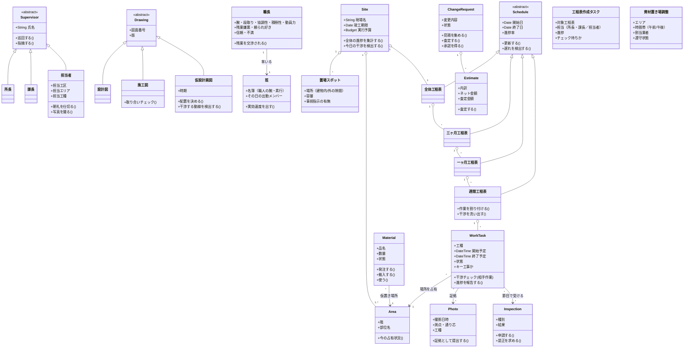

# 現場監督オブジェクトモデル v1

作成：2026-11-08
更新：2026-11-08（会話で確定した事項 U1〜U8 を反映。更新箇所には（2026-11-08 更新）の印を付けた）
位置づけ：DOMAIN_MODEL.md の概念を、クラス（属性・操作・状態）として具体化したもの。将来のゲーム／アプリ実装の設計図として使う想定。表記は擬似UML。

## クラス図（骨格）

## 主要クラスの責務・属性・操作

### 人と組織
| クラス | 主な属性 | 主な操作（業務） | 備考 |
|---|---|---|---|
| 所長 | 現場、権限（最終確認） | 大きな絵を描く（全体工程）、変更を確認する、本社と交渉する、非常時に対応する | 現場に1人。状態というより権限のクラス |
| 課長 | 担当範囲、経験年数、繁忙度（2026-11-08 更新） | 工程表（3ヶ月）を作る/更新する、施工図をチェックする、見積を査定する、仮設計画を立てる、巡回で指摘する、1ヶ月工程をチェックして返す（速度は繁忙度で決まる）（2026-11-08 更新） | 計画の中核 |
| 担当者 | 担当工区、担当エリア、担当工種 | 朝礼・KYを仕切る、巡回する、作業を指示する、資材を手配する、写真を撮る・整理する、看板を作る、日報を書く、1ヶ月工程を作る、日次レビューと残業交渉をする、工程表の下書きを肩代わりする（巡回・写真が止まる）（2026-11-08 更新） | 実行レイヤー。1日の大半がこれらの操作の連続 |
| 職長 | 所属業者、工種、パラメータ（腕・段取り・協調性・積極性・動員力＋残業嫌悪・頼られ好き）、信頼（職長ごと）、不満（2026-11-08 更新） | 作業を割り振る、朝礼で発表する、調整会議に出る、残業の交渉に応じる（抵抗・説得・最終拒否）（2026-11-08 更新） | 協力業者側のリーダー。パラメータには業種ごとの傾向分布がある（FOREMAN_CHARACTERS.md） |
| 職人 | 工種、技能、腕、素行（2026-11-08 更新） | 作業する、墨出しする、是正する | 班（作業班）としてまとまることが多い。素行の低い職人は近隣クレームの発生源になり得る（2026-11-08 更新） |
| 班（作業班）（2026-11-08 更新） | 名簿（職人ごとの腕・素行）、その日の出勤メンバー、実効速度、班の疲労 | 出勤する（日替わり）、作業する、休む | 職長が率いる。出勤メンバーの構成でその日の進みが変わり、職長の腕・段取りがばらつきを均す |
| 協力業者（サブコン）（2026-11-08 更新） | 工種、入場予定日・入場状態、業者の疲労、動員力 | 入場する（工程に合わせて順次）、作業を請け負う、応援を出す | 着工時に全社揃うわけではない。若手の離職は動員力を落とす |
| 図面屋 | － | 施工図を作図する | 担当者が指示・確認する相手 |

### 計画・文書
| クラス | 主な属性 | 主な操作 | 状態・版管理 |
|---|---|---|---|
| 工程表（抽象） | 期間、粒度、進捗率、版 | 更新する、遅れを検出する、下位へ詳細化する | 常に「最新版」がどれかが問題になる（版の混乱はあるある） |
| 全体工程表 | 工期、キー工事の日程 | キー工事をマークする | キー工事の日程は不変条件に近い。（2026-11-08 更新）着工時点で完成済みであることが前提 |
| 三ヶ月工程表（2026-11-08 更新） | 対象期間、確定状態 | 所長＋課長が作成する（工程表作成タスク）、業者手配の根拠になる | 未着手 → 作成中 → 確定。確定の遅れは業者手配（入場・補充メンバーの質）を悪化させるが、メインの職人は変わらない |
| 一ヶ月工程表（2026-11-08 更新） | 対象月、作成者（担当者）、チェック状態、出来の良し悪し | 担当者が作成する、課長がチェックして返す、日次レビューで予実を見る | 作成中 → チェック待ち → 返却・確定。有効な間は「指示が適切」で段取りが良くなり、失効すると干渉・手戻りが増える |
| 工程表作成タスク（2026-11-08 更新） | 対象工程表、担当、進捗、締切 | 進める、肩代わりされる、下書きを渡す | 未着手 → 作成中 →（1ヶ月の場合）チェック待ち → 確定。課長の繁忙度が速度を決める |
| 週間工程表 | 日、業者、場所、人数、重機 | 作業を割り付ける、干渉を洗い出す | 作業間連絡調整会議で確定する |
| 施工図 | 図面番号、版、工種、納まり | 取り合いチェックを受ける、承認される | 未承認では施工できない |
| 仮設計画図 | 時期（工程段階）、配置、動線 | 配置を決める、一番厳しい工程で検証する | 工程の節目ごとに版が変わる（時期別配置図） |
| 見積書 | 内訳、数量、単価、掛け率、ネット金額 | 査定される、交渉される | 査定金額との差異が交渉の対象 |
| 実行予算 | 目標金額、消化状況 | 達成度を測る | 本社・支店が設定。現場は読む側 |
| 施工写真 | 撮影日時、工種、測点・通り芯、対象部位（部材カテゴリ）、小黒板情報、必要量区分（全数近く／抜粋）、充足率（2026-11-08 更新） | 撮る、整理する、提出する | 隠蔽部の写真は撮り直し不可＝生成タイミングが一意。管理単位は工区ではなく部材（実質は業者ごと）で、証拠の充足はカテゴリ充足率で判定する（2026-11-08 更新） |
| 作業日報 | 日付、場所、内容、人数、機材、出来高、翌日予定 | 書く、指示書と突き合わせる | 計画（指示書）との差分が翌日の調整材料 |

### 空間・モノ
| クラス | 主な属性 | 主な操作 | 状態遷移 |
|---|---|---|---|
| エリア（階・部位） | 階、部位、工区 | 占有状況を見る | 空き → 作業中 → 完了 → 次工種へ |
| 資材置場 | 容量、固定/可変、3定ルール | 置く、溢れを検出する | 余裕 → 適正 → 逼迫 → 溢れ（動線を塞ぐ） |
| 置場スポット（2026-11-08 更新） | 場所（建物内/外の隙間）、容量、事前指示の有無、塞いではいけない場所か | 指示される、置かれる、巡回で確認される、移動指示を受ける | 置場の最小単位。専用ヤードではなく隙間に設ける。建物内スポットは、その区画の内装開始を遅らせる代償を持つ。通路・EV前・階段前・搬入口は原則「置いてはいけない場所」 |
| 資材・部材 | 品名、数量、必要時期、置場 | 発注→搬入→仮置き→使用 | 下の状態機械を参照 |
| 重機 | 種別、作業半径、設置位置 | 予約する、据え付ける、稼働する | 時間割で複数業者が共有する資源。（2026-11-08 更新）クレーンとゲートは時間枠の競合資源で、資材置き場調整で調整する |
| 搬入車両 | 車種、大きさ、到着予定 | 経路を通る、待機する | 経路の実測と直前踏査が前提 |
| 仮設物 | 種別、設置場所、設置期間 | 設置する、移設する、撤去する | 工程の進行で生まれては消える。（2026-11-08 更新）外部足場は面ごとに 組立 → 存置 → 解体 で、解体はその面の外装完了の宣言になる |
| 建物の部位 | 部位名、設計寸法、実測寸法、隠蔽されるか | 施工される、検査を受ける、写真に残る | 未施工 → 施工中 → 隠蔽 → 完成 |

### 出来事
| クラス | 主な属性 | 主な操作 | 状態遷移 |
|---|---|---|---|
| 作業（WorkTask） | 工種、場所、期間、担当業者、人数、使う重機、前後関係、キー工事か | 段取りする、開始する、進捗を報告する、完了する | 下記 |
| 検査 | 種別（社内/中間/完了/施主）、対象、結果 | 申請する、受ける、結果を記録する | 申請 → 実施 → 合格 / 不合格 → 是正 → 再検査。（2026-11-08 更新）実務の成立はチェーン：書類作成中（証拠収集中）→ 申請・依頼済 → 実施 → 判定 → 是正 → 再確認 → 完了。下記の状態機械を参照。竣工時の検査群は 自→監→施→法 の順序制約を持つ |
| 資材置き場調整（2026-11-08 更新） | エリア、時間帯（午前/午後）、割当業者、遵守状態、巡回確認の有無 | 割り当てる、遵守/違反する、巡回で確認する、職長同士で融通する | 未割当 → 割当済 → 遵守 / 違反（動線封鎖など）→ 巡回確認済。工程に余裕がある時期は自律融通で違反が解消されることがある |
| 日次レビュー（2026-11-08 更新） | 日付、1ヶ月工程の予実、遅れ日数、近づくマイルストーン | 進捗を確認する、残業可否を決める、立て直しを選ぶ | 夕方の型：レビュー → 残業決定 → 立て直し → 翌日へ |
| 指摘・是正 | 箇所、内容、期限、担当 | 指摘する、是正する、完了を確認する | 指摘 → 是正中 → 確認済 |
| 設計変更 | 変更内容、指示者、影響（QCDSE） | 見積を集める、査定する、承認を得る、施工する | 指示 → 見積徴収 → 査定 → 施主承認 → 所長確認 → 施工 → 精算 |
| 朝礼・KY | 日付、当日の作業、危険箇所 | 発表する、共有する、指差呼称する | 毎朝の同期イベント |
| 作業間連絡調整 | 日付、参加職長、干渉リスト | 干渉を洗い出す、時間分離・立入禁止を決める、エリア図に反映する | 決めた内容が「本日の作業エリア図」になる |
| 巡回記録 | 日時、巡回者、指摘一覧 | 歩く、記録する、是正を追跡する | 指摘は是正クラスへ引き継がれる |

## 状態機械（主要なもの）

**作業 WorkTask**
計画 → 段取り済（人・モノ・場所が揃った） → 作業中 → 完了 → 検査済 → 確定
分岐：干渉あり（調整待ち）、資材待ち、天候待ち、是正中（検査不合格から戻る）

**資材 Material**
未発注 → 発注済 → 納品予定（日時確定） → 搬入（経路を通る） → 仮置き（置場を占有） → 使用 → 残材（保管 or 産廃へ）

**設計変更 ChangeRequest**
指示発生 → 見積徴収中 → 査定中 → 承認待ち（施主） → 確認済（所長） → 施工 → 精算済
打ち切り分岐：却下、保留（「法的には可能です」で再考を促す状態もここ）

**施工図 Drawing（施工図）**
作図中 → 自己チェック → 社内チェック（赤入れ）→ 修正 → 提出（質疑応答書とセット）→ 監理者確認中 → 指摘あり（修正・再提出）／承諾（一部は部分承諾で先行確定）→ 配布・版切り替え → 施工に使用 → （変更で新版へ。旧版は破棄印を押して保管）
操作：重ね合わせで干渉を確認する、質疑を起票する、指摘に回答する（修正内容と回答文の一致確認）、未決事項を一覧管理する、部分承諾を申請する。詳細：TASKS_DRAWING_CHECK.md

**確認 Check（Q/D/S共通）**
予定 → 実施期限到来 → 実施（自主検査／立会い）→ 判定（合格／条件付合格／不合格）→ 是正指示 → 是正中 → 是正完了報告 → 再確認 → 完了（ゲート開放：次工程可／閉鎖可／打設可）
属性：観点（Q/D/S）、対象（部位・工区・作業・資材）、判定基準、方法、確認者、立会者、証拠（写真・実測値・記録）、是正担当、期限、ゲート状態。詳細：TASKS_CONFIRM_QDS.md（Q1〜Q8、D1〜D7、S1〜S8 の確認カタログ）

**エリア Area**
未着手 → 作業中（1作業が占有） → 完了 → 引継ぎ（次工種の作業へ）／ 競合中（複数作業が取り合い＝調整対象）

**検査 Inspection（チェーン）（2026-11-08 更新）**
予定（マイルストーン） → 書類作成中（証拠＝写真・ミルシート・試験結果を集める。揃わないと進まない） → 申請・依頼済（期限つきの明示行為。未了のまま節目を迎えると実施できず後工程が止まる） → 実施（立会い） → 判定（合格／条件付合格／不合格） → 是正 → 再確認 → 完了（ゲート開放）
竣工時の検査群は複数が連なる：自主検査（自）→ 監理者検査（監）→ 施主検査（施）→ 法定完了検査（法）

**工程表作成タスク ScheduleAuthoring（2026-11-08 更新）**
未着手 → 作成中 → 確定（3ヶ月工程：所長＋課長が作成）
1ヶ月工程は2段：担当者 作成中 → 課長チェック待ち → 返却（修正指示あり／確定）。返却速度は課長の繁忙度で決まる。担当者が下書きを肩代わりすると作成中が速く進むが、その日は巡回・写真が止まる

**職長 Foreman（協力と不満）（2026-11-08 更新）**
通常 → 残業交渉中（抵抗 → 説得（手を2回まで）→ 受諾 ／ 最終拒否）
不満の蓄積：押し切った残業・連日の残業で加算、残業なしの日・休日で減衰 → 限界超過で「言うことを聞かない」（残業以外の頼みも効かない） → 休ませる期間＋関係修復（謝罪・差し入れ）→ 通常
頼られ好きの職長は逆方向：頼まれることで信頼が上がる（ただし班の疲労限界は共通）

**班 Crew の日次（2026-11-08 更新）**
名簿（固定のメイン職人＋補充メンバー）から、その日の出勤メンバーが決まる（日替わり） → 班の実効速度＝人数と平均の腕（職長の腕・段取りで均される） → 業者疲労の増減（残業・連日で加算、休みで回復） → 若手の酷使が続くと離職し、名簿と動員力が痩せる

**昇降機 EV 工事（2026-11-08 更新）**
昇降路引渡し → レール据付（危険作業） → かご・巻上機 → 配線・試運転 → 落成検査 → 養生 → 工事用解放（内装・上階作業の搬送効率が上がる）／解放しない場合は本設のまま完了検査へ

## 協調の型（オブジェクト同士のやり取りの典型）
1. **朝の同期**：週間工程表 → 当日の作業一覧 → 朝礼（担当者が読み上げる）→ TBM/KY（職長が班に展開）→ 作業開始。途中で干渉が見つかれば作業間連絡調整が割り込む。
2. **変更の伝播**：現場の変化（搬入遅れ・天候・指摘）→ 担当者が検出 → 週間工程表を組み替え → 影響が大きい場合は3ヶ月工程表・全体工程表まで波及 → 関係業者へ再指示。
3. **証拠の生成**：作業の節目（隠蔽直前）→ 担当者が写真を撮影（部位・測点と紐づけ）→ 検査で提示 → 合格で次工程へ。写真がないと検査で止まる。
4. **原価の締め**：設計変更 → 見積徴収 → 課長が査定（見積ソフトで自社見積と照合）→ 施主承認 → 所長確認 → 施工 → 出来高に応じて支払い。実行予算の残高が全体を拘束。
5. **空間の受け渡し**：前工種の作業完了 → 片付け・清掃（3定の状態に戻す）→ 次工種がエリアを占有。受け渡しの失敗（資材が残る・汚い）が次作業の開始条件を壊す。
6. **検査チェーン（2026-11-08 更新）**：節目が近づく → 担当者が証拠（写真・ミルシート・試験結果）を集めて書類を作る → 期限までに申請・依頼する → 立会い実施 → 判定 → 是正 → 再確認 → 次工程のゲートが開く。どれか1段でも欠けると節目で止まる。
7. **資材置き場調整と自律融通（2026-11-08 更新）**：前日〜朝に エリア×時間帯 を割り当てる → 職長が遵守する/しない → 重要な箇所は担当者が巡回で確認する。工程に余裕がある時期は、割当の衝突を職長同士が話し合って自分たちで解消する。
8. **日次レビューと残業交渉（2026-11-08 更新）**：夕方、1ヶ月工程の予実を確認 → 遅れと明日のキー作業・疲労・予算を見て残業を交渉する（職長の抵抗・説得・最終拒否）→ 立て直し（応援・先行など）を決めて翌日へ。

## ゲーム化への接続メモ（参考）
- プレイヤーが直接操作するオブジェクトは「作業・工程表・エリア・資材・仮設配置」が中心になると、ドメインの芯（場所×時間の占有と干渉）に触れる設計になる。
- 所長・課長・担当者は「権限と視野の範囲」が違うクラスとして実装できる（見える情報と決められる範囲の差）。
- 状態機械はそのままゲームの進行ルールに転用できる（例：隠蔽前に写真を撮り忘れると検査で詰む）。
