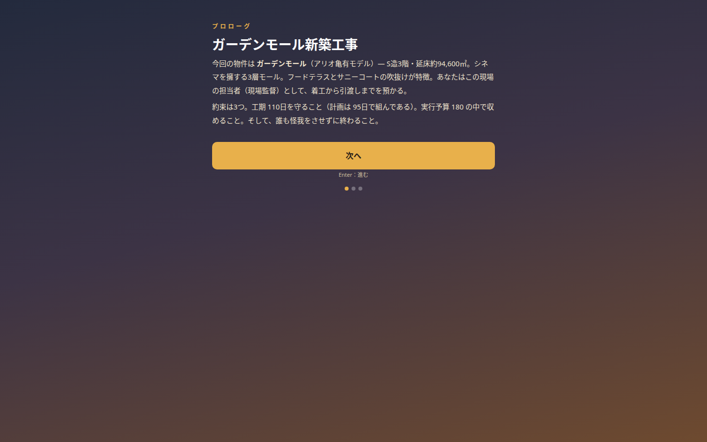

# research — 調査・試作の置き場

ゲーム本編の設計・生成ロジックの裏付けになった調査結果と、試作（プロトタイプ）を区分ごとに保存する場所。各区分の README に概要・結論・撮影画像を置く。

| 区分 | 内容 |
|---|---|
| [prototypes/](prototypes/) | 試作スペースのコード一式（3D試作／アイソメ2.5D検証／工事計画タイムラプス／トゥーン縮尺サンドボックス） |
| [building-generation/](building-generation/) | 物件生成ロジック（建物モデル生成の調査・検証） |
| [construction-plan/](construction-plan/) | 工事計画生成ロジック（数量→工期・原価の導出） |
| [scene-3d/](scene-3d/) | 3Dモデル生成ロジック（工事計画→部材イベント列 ScenePlan） |
| [terminology/](terminology/) | 現場用語・熟語の調査 |
| [site-research/](site-research/) | その他の現場調査（外構、図面チェック、労働災害事例など） |

