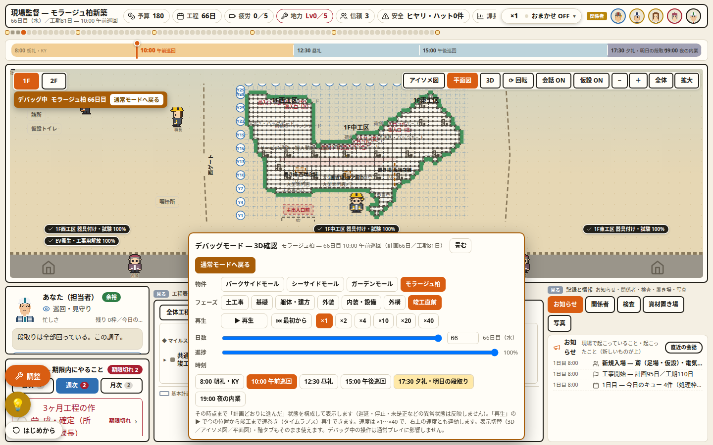

# building-generation — 物件生成ロジックの調査

建物を「データ」として生成するロジック（平面形状・グリッド・柱・室・コア等）の調査と検証結果。正は本編プロジェクトの `model/BUILDING_MODEL_SCHEMA.md`（v0.7）と `model/INTERIOR_MODEL_V2.md`、生成コードは `model/` 配下。

## 主な結論

- 大規模商業S造の構造グリッドは 9m×9m（実務範囲8〜10m）が標準。構造軸と補助軸を分離し、柱は構造交点のみ（`model/SPAN_STANDARD.md`）
- PLATEAUオープンデータの実測フットプリントを種に実在建物を再現できる（モラージュ柏で形状一致度 IoU 0.946）
- 階数・構造など実測できない項目は推定として区別し、種情報の出所（seed/inference/default/gap）を全項目に記録する

## 調査資料

- `span_standard_research.md` / `column_section_research.md` / `structural_inference_research.md`
- `ario_soga_whole_building_research.md` / `back_of_house_planning_research.md`
- `building_footprint_opendata_research.md`（PLATEAU等のオープンデータ）
- `use_rules_commercial_research.md` / `use_rules_mansion_research.md` / `ikkyu_sekkei_seizu_research.md`
