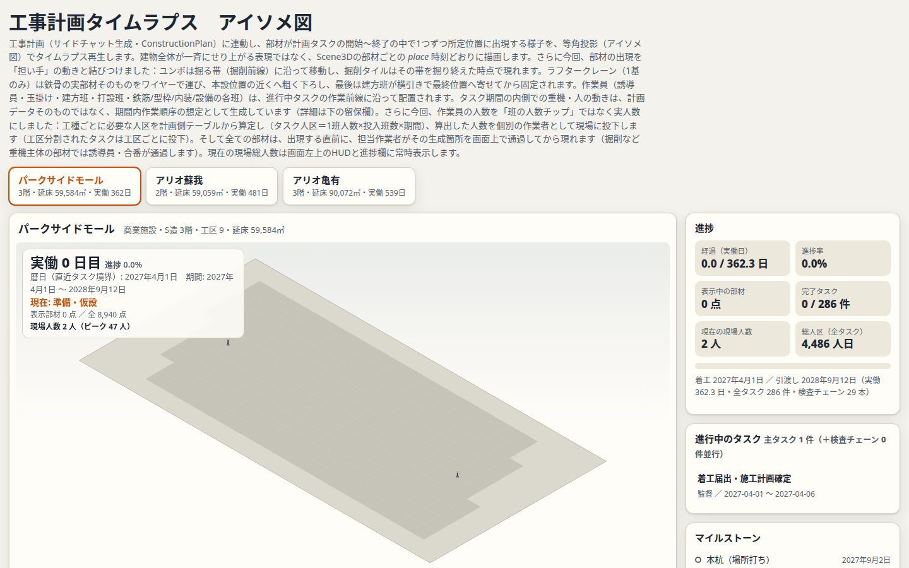

# construction-plan — 工事計画生成ロジックの調査

建物モデルから工事計画（工程・工期・原価）を「入力ではなく導出」で生成するロジックの調査と実装記録。正は `model/CONSTRUCTION_PLAN_GENERATION.md`、実装は `model/plan_generate.py` ほか、記録は `model/PLAN_PIPELINE.md`。

## 主な結論

- 工期・原価は延床面積からの換算式では出ない。形状→数量→（歩掛×投入数）で工期、（単価）で原価を積み上げる数量モデルが唯一の実務経路
- 計画の完成は様式ではなく検証条件 PL-01〜PL-12 で判定する（検査ゲートの完全性を含む）
- 生成は3層： A 自動生成／B 推論ルール／C 人の判断（ゲームではプレイヤーの判断と難易度シード）

## 調査資料

- `inspection_milestones_research.md`（検査マイルストーン）
