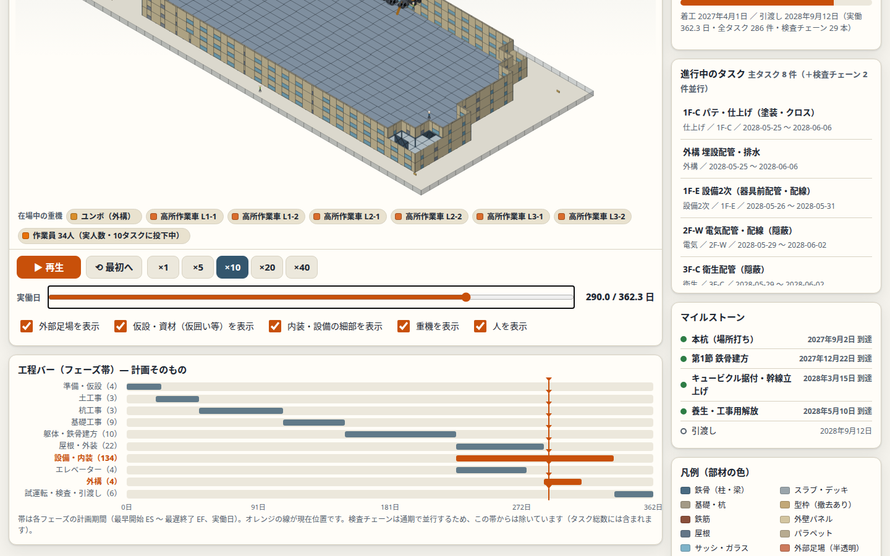
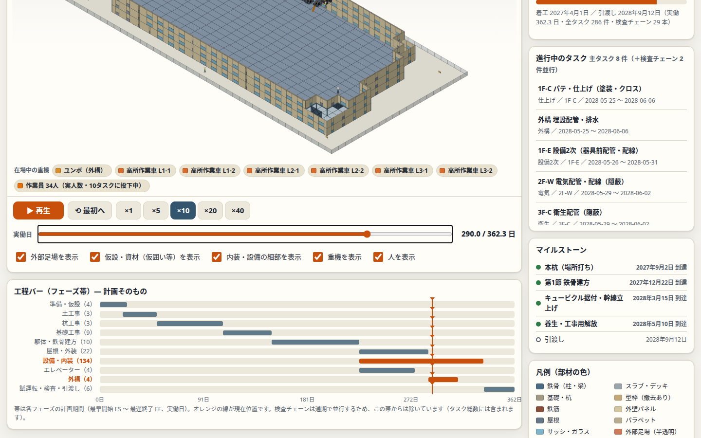

# 工事計画タイムラプス アイソメ図

工事計画生成ロジックが出した ConstructionPlan と、3D生成ロジックの部材イベント列（ScenePlan）に直接連動し、計画どおりに部材が1つずつ積み上がるタイムラプス表示。担い手（重機・作業者）の動きと部材出現を連動させる改修済み。

- コード: `index.html`
- データ生成: 本編プロジェクトの `iso_timelapse/`（prepare_data.py）参照
