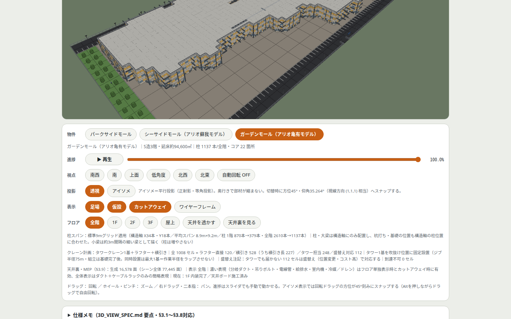
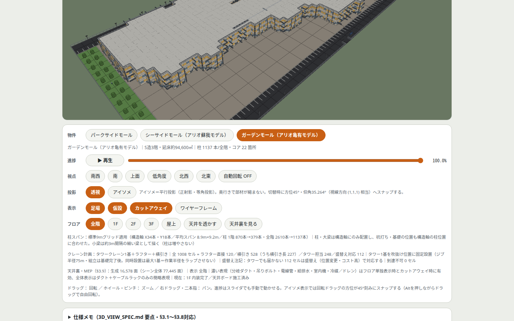

# scene-3d — 3Dモデル生成ロジックの調査

建物モデル＋工事計画から、部材の出現・撤去イベント列（ScenePlan）を生成するパイプラインの調査と仕様。正は `model/SCENE3D_PIPELINE.md`、規則は `model/scene_rules.json`、生成・検証は `model/scene_expand.py` / `model/scene_validate.py`。

## 主な結論

- 部材粒度は全数、展開規則はデータテーブル（JSON）で持ち、人物・重機の動きもイベント列に含める
- 検証 SV-01〜07 を独立再計算で照合する（生成側の自己申告にしない）
- 揚重はラフタークレーン＋横引きが原則。タワークレーンは同時複数基を計画しない（旋回半径の重なり事故防止）

## 調査資料

- `rooftop_equipment_research.md`（屋上・屋外設備）/ `roof_work_research.md`（屋上工事）
- `mep_interior_research.md`（天井裏・設備の順序）/ `spatial_methods_research.md`（空間把握の伝統的手法）
